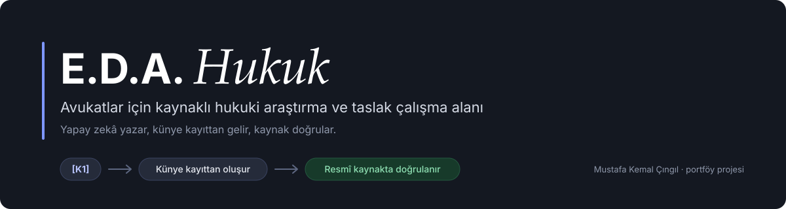
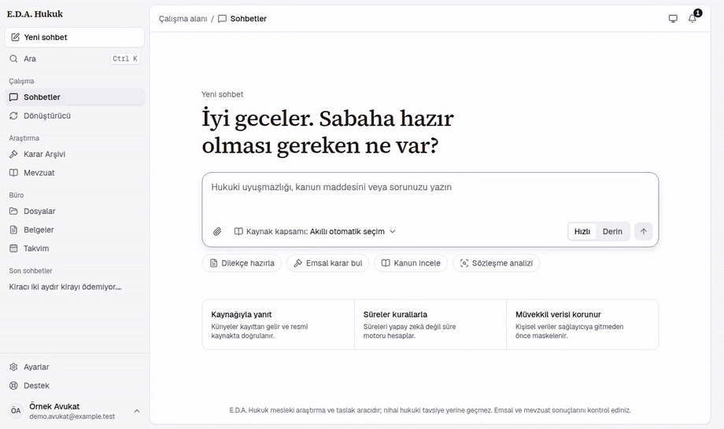
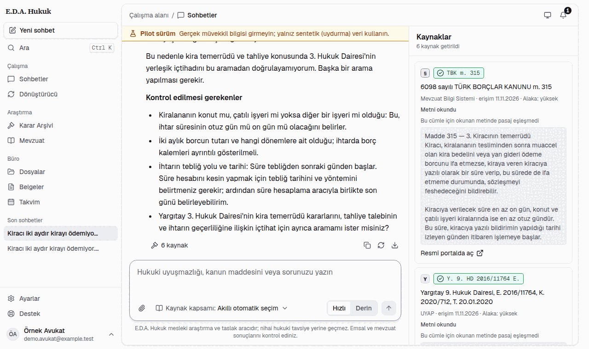
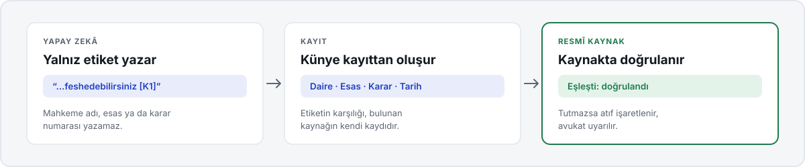

<p align="center">
  
</p>

<p align="center">
  
  
  
  
  
  
</p>

<p align="center">
  <a href="#nedir">Nedir?</a> ·
  <a href="#örnek-çalışma">Örnek çalışma</a> ·
  <a href="#künye-kilidi">Künye Kilidi</a> ·
  <a href="#özellikler">Özellikler</a> ·
  <a href="#veri-güvenliği">Veri güvenliği</a> ·
  <a href="#geliştiriciler-için">Geliştiriciler için</a> ·
  <a href="#lisans">Lisans</a>
</p>

> [!IMPORTANT]
> Bu bir **portföy projesidir** ve **kaynak görünürdür (source-available); açık kaynak değildir.**
> Kodu okuyabilir, kendi bilgisayarınızda yalnız kişisel ve ticari olmayan değerlendirme için çalıştırabilirsiniz.
> **Ticari kullanım, kodun veya mimarisinin başka bir projede kullanılması, türev eser üretilmesi ve proje adının
> kullanılması yasaktır.** Ayrıntı: [Lisans](#lisans).

---

<a id="nedir"></a>
## Nedir?

**E.D.A. Hukuk**, avukatların, stajyer avukatların ve hukuk bürolarının günlük işini tek ekranda toplayan bir
çalışma alanıdır: soruyu yazarsınız, sistem ilgili **kanun maddesini ve kararları resmî kaynaklarda arar**, yanıtı
**kaynaklarıyla birlikte** verir; aynı yerden dilekçe taslağı hazırlar ve Word ya da PDF olarak indirirsiniz.

Genel amaçlı yapay zekâ araçlarının hukukta bilinen bir sorunu vardır: var olmayan kararı, var olmayan esas
numarasıyla, çok inandırıcı biçimde yazabilirler. E.D.A. Hukuk bu sorunu çözmek üzere tasarlandı:

|  |  |
|---|---|
| **Karar uydurmaz** | Yapay zekâ künye yazamaz. Yalnız `[K1]` gibi bir etiket koyar; mahkeme, esas, karar ve tarih bilgisi bulunan kaynağın kendi kaydından gelir. |
| **Bulamadığını söyler** | Aradığı kararı bulamazsa bunu açıkça yazar; alakasız bir kararı emsal gibi sunmaz. |
| **Süreyi yapay zekâ hesaplamaz** | Süreler, kuralları kodlanmış bir süre motoruyla hesaplanır. |
| **Son söz avukatındır** | Bu bir araştırma ve taslak aracıdır; hukuki görüş vermez, avukatın değerlendirmesinin yerine geçmez. |

---

<a id="örnek-çalışma"></a>
## Örnek çalışma

Aşağıdaki kayıt **uygulamanın kendi arayüzünden** alınmıştır; çizim ya da canlandırma değildir. Örnek bir hesapla,
kurgusal bir soru soruluyor: sistem önce TBK m. 315 metnini getiriyor, ardından emsal karar arıyor ve yanıtı
kaynak paneliyle birlikte veriyor.

<p align="center">
  
</p>

Kayıtta dikkat edilecek üç şey:

1. **Adımlar görünür.** "Madde metni getiriliyor", "Resmî kaynakta aranıyor" gibi adımlar ekranda izlenir; sistemin
   neye dayanarak yazdığı gizli kalmaz.
2. **Kaynak paneli.** Sağ tarafta getirilen maddenin metni, hangi kaynaktan ve hangi tarihte alındığı ve resmî
   portalda açma bağlantısı yer alır.
3. **Dürüst sonuç.** Bu örnekte istenen dairenin kararı bulunamadı; sistem bunu yanıtta açıkça belirtti ve
   bulduğu kararları emsal olarak sunmadı.

<p align="center">
  
</p>

> Kayıttaki hesap ve soru kurgusaldır; gerçek bir müvekkile ya da dosyaya ait değildir.

---

<a id="künye-kilidi"></a>
## Künye Kilidi

Projenin temel fikri budur: **atıf, yapay zekânın hafızasından değil kaynaktan gelir.**

<p align="center">
  
</p>

- Yapay zekâ metinde yalnız `[K1]`, `[K2]` gibi etiketler kullanır.
- Her etiketin künyesi (daire, esas, karar, tarih) arama sonucunda gelen kayıttan oluşturulur.
- Künye resmî kaynaktaki kayıtla karşılaştırılır. Tırnak içindeki alıntılar da kaynak metinde aranır.
- Doğrulanamayan atıf işaretlenir; bulunamayan bir atıfla belge dışa aktarılamaz.

---

<a id="özellikler"></a>
## Özellikler

<table>
<tr>
<td width="33%" valign="top">

**Kaynaklı sohbet**<br>
Karar ve mevzuat resmî kaynaklarda canlı aranır. Yanıttaki her atıfta kaynağın adı ve erişim tarihi görünür.

</td>
<td width="33%" valign="top">

**Karar ve madde bulma**<br>
Esas ve karar numarasından kararı, kanun numarası ve madde numarasından madde metnini doğrudan getirir.

</td>
<td width="33%" valign="top">

**Dilekçe stüdyosu**<br>
A4 sayfa görünümlü editör, sürüm geçmişi, bul ve değiştir, seçili bölümü sohbetle düzenleme.

</td>
</tr>
<tr>
<td width="33%" valign="top">

**Word ve PDF**<br>
Taslaklar Word ya da PDF olarak indirilir. UDF, Word ve PDF arasında dönüştürücü bulunur.

</td>
<td width="33%" valign="top">

**Dosyayla sohbet**<br>
Metinli PDF ve Word dosyalarını yükleyip içeriği hakkında soru sorabilirsiniz. Dosyalar virüs taramasından geçer.

</td>
<td width="33%" valign="top">

**Süre motoru ve takvim**<br>
Süreler kural motoruyla hesaplanır ve takvime işlenir; hesabı yapay zekâ yapmaz.

</td>
</tr>
<tr>
<td width="33%" valign="top">

**Büro yönetimi**<br>
Roller (büro sahibi, avukat, stajyer, asistan), davet ve yetki ayrımı.

</td>
<td width="33%" valign="top">

**Kendi anahtarınız**<br>
Büro ya da avukat kendi yapay zekâ anahtarını tanımlar; anahtar şifreli saklanır ve ekranda yalnız son dört
karakteri görünür.

</td>
<td width="33%" valign="top">

**Yönetim paneli**<br>
Başvuru onayı, kullanıcı ve limit yönetimi, denetim kaydı, kaynak durumu izleme.

</td>
</tr>
</table>

---

<a id="veri-güvenliği"></a>
## Veri güvenliği

Avukat için asıl soru şudur: *müvekkil bilgisi nereye gidiyor?*

- **Veri sınıfı kapısı.** Her içerik bir sınıf taşır: kamuya açık, müvekkil, dosya. Bir yapay zekâ sağlayıcısı
  yalnız izin verildiği sınıftaki veriyi alabilir; izin yoksa istek hiç gönderilmez.
- **Maskeleme.** Kimlik numarası, telefon, IBAN gibi kişisel veriler sağlayıcıya gitmeden önce maskelenir.
- **Büro ayrımı.** Her büronun verisi veritabanı düzeyinde ayrılmıştır; bir büro diğerinin kaydını göremez.
- **Giriş güvenliği.** Parola ile birlikte iki adımlı doğrulama; yönetim paneli ayrı bir kimlik sistemiyle çalışır.
- **Kayıt tutma.** Önemli işlemler denetim kaydına yazılır; günlüklerde içerik, anahtar ve çerez yer almaz.

> [!NOTE]
> Bu depo bir portföy çalışmasıdır. Gerçek müvekkil verisiyle, üretim ortamında kullanılmak üzere hazırlanmış bir
> ürün olarak sunulmamaktadır.

---

<a id="geliştiriciler-için"></a>
## Geliştiriciler için

Docker ile çalışan bir monorepo (pnpm + Turborepo; yalnız belge motoru Python/uv).

```
apps/web             Next.js 16 · tanıtım ve uygulama arayüzü (yalnız arayüz; iş mantığı yok)
apps/admin           Next.js 16 · yönetim paneli (ayrı yüzey)
apps/api             Hono 4 · uygulama API'si ve ayrı yönetim API'si (iki dinleyici)
apps/worker          BullMQ · dosya tarama, metin çıkarma, e-posta, zamanlanmış işler
services/yargi-mcp   Kaynak aramaları için MCP sunucusu (durumsuz, salt okur)
services/doc-engine  Python · belge işleme
packages/*           contracts (Zod tek kaynak), db (Drizzle + RLS), ai (LLM geçidi), kvkk (maskeleme),
                     legal (süre motoru, künye), editor, ui, crypto, email, observability
infra/               Compose, Caddy, PostgreSQL ve Valkey yapılandırmaları
```

**Seçilmiş tasarım kararları**

- **Kiracı izolasyonu:** PostgreSQL satır düzeyi güvenlik (RLS); her kiracılı tabloda izolasyon testi.
- **Sırlar:** Yapay zekâ anahtarları AES-256-GCM ile şifrelenir; yanıtlar anahtarı hiç döndürmez.
- **Kimlik:** Parola + TOTP, geçiş anahtarı (passkey), yönetim yüzeyi için ayrı kimlik sistemi.
- **Web güvenliği:** Nonce'lu CSP, CSRF için origin denetimi, hız sınırları, denetim günlüğü.
- **Yapay zekâ geçidi:** Veri sınıfı kapısı fail-closed çalışır; araç seti her istekte aynı sırada gider.
- **Kontrat öncelikli:** Dış sınırlardaki her girdi Zod ile doğrulanır; adlar ve değerler tek kaynaktan gelir.

### Yerel olarak çalıştırma (değerlendirme amaçlı)

Bilgisayarda yalnız Docker (Compose v5), Make ve git gerekir.

```bash
git clone https://github.com/MustafaKemal0146/eda-hukuk-public.git
cd eda-hukuk-public
make setup
make dev            # sahte (mock) modelle çalışır; anahtar gerekmez
```

Uygulama `https://app.eda.localhost:8443` adresinde açılır (yerel sertifika; tarayıcı uyarı verebilir). Yerel
e-postalar Mailpit'te görünür: `http://127.0.0.1:8025`. Yığını kapatmak için `make down`.

Yerel bir hesap kurmak için (kayıt, doğrulama, başvuru ve onay adımlarını otomatik yapar):

```bash
DEV_ACCOUNT_PASSWORD='<parola>' make dev-account EMAIL=ben@example.test
```

Başvuruyu onaylayacak yerel yönetici ve diğer ayrıntılar: [`docs/gelistirme.md`](docs/gelistirme.md).

### Geliştirme süreci

Proje, **Claude Code** ile yapay zekâ destekli geliştirildi; planlama, mimari kararlar, inceleme ve yayın
sorumluluğu proje sahibindedir. Geliştirme sürecindeki toplam yapay zekâ kullanım maliyeti, kullanım panelinde
görüldüğü üzere **yaklaşık 1.400 ABD doları** olmuştur (geliştirici beyanı).

---

<a id="lisans"></a>
## Lisans

**E.D.A. Hukuk Kaynak Görüntüleme ve Değerlendirme Lisansı (v1.0)** — [`LICENSE`](LICENSE)

| | |
|---|---|
| Kodu okumak, incelemek | **Serbest** |
| Kendi bilgisayarınızda kişisel, ticari olmayan değerlendirme için çalıştırmak | **Serbest** |
| Ticari kullanım (büro ya da şirket içi kullanım ve hizmet olarak sunma dahil) | **Yasak** |
| Kodu, mimarisini, şemalarını, istemlerini veya tasarımını başka bir projede kullanmak, uyarlamak, türev eser üretmek | **Yasak** |
| Yeniden dağıtmak, yayımlamak, canlı hizmet olarak sunmak | **Yasak** |
| Yapay zekâ modeli eğitmek veya veri seti oluşturmak için kullanmak | **Yasak** |
| "E.D.A. Hukuk", "Expert Digital Assistant" adlarını ve logoyu kullanmak | **Yasak** |

Fikirler serbesttir; lisans kodun, metnin ve tasarımın özgün ifadesini korur. Üçüncü taraf bileşenler kendi
lisanslarına tabidir ([`THIRD_PARTY_NOTICES.md`](THIRD_PARTY_NOTICES.md)). Ticari lisans veya izin için GitHub
üzerinden ulaşabilirsiniz: [@MustafaKemal0146](https://github.com/MustafaKemal0146).

## Yazar

**Mustafa Kemal Çıngıl** — tasarım, mimari ve geliştirme · [@MustafaKemal0146](https://github.com/MustafaKemal0146)

Telif Hakkı (c) 2026 Mustafa Kemal Çıngıl. Bildirimler: [`NOTICE.md`](NOTICE.md).

---

<details>
<summary><b>English summary</b></summary>

**E.D.A. Hukuk** is an AI-assisted legal research and drafting workspace for Turkish lawyers: source-backed
research with a citation lock (the model emits only a `[K1]` label; the citation is rendered from a record and
checked against the official source), a drafting studio with Word/PDF export, a rules-engine deadline calculator,
and client-data protection with masking and a data-class gate. The recording above was captured from the real
application running locally with a fictional account and question.

This is a **source-available portfolio project, not open source**. You may read the code and run it unmodified on
your own computer for personal, non-commercial evaluation. Commercial use, reuse or adaptation of any part of the
code or architecture in another project, redistribution, AI-training use and use of the name are prohibited. See
[`LICENSE`](LICENSE). It was built with AI assistance (Claude Code); the author reports a total AI usage cost of
roughly USD 1,400. It is not legal advice and not intended for production use with real client data.

Author: Mustafa Kemal Çıngıl · Licensing contact: via GitHub (@MustafaKemal0146)

</details>
